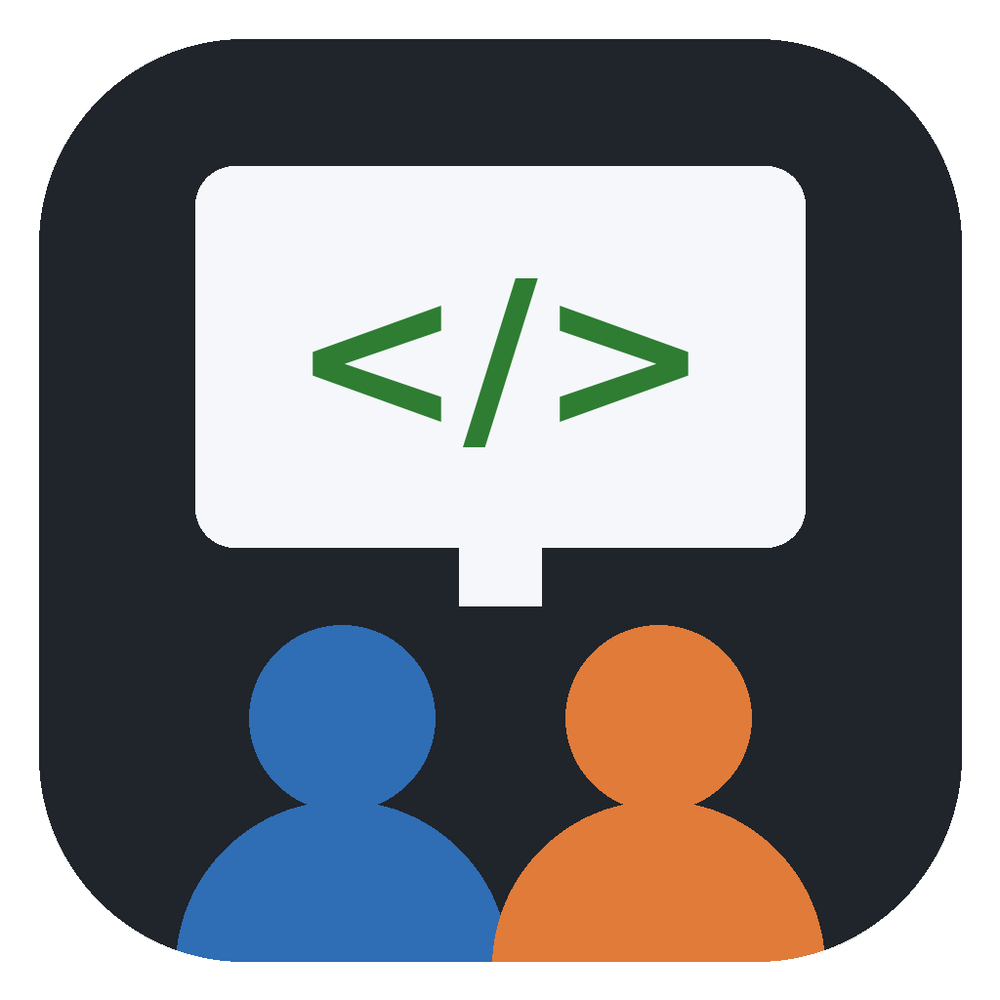
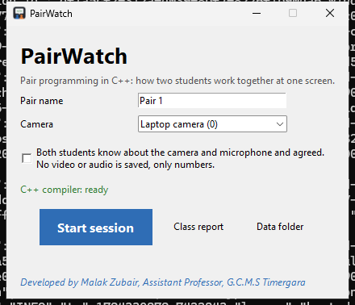
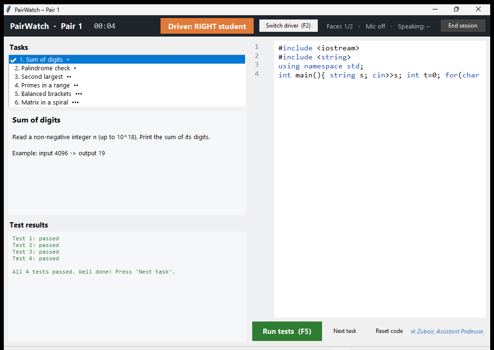
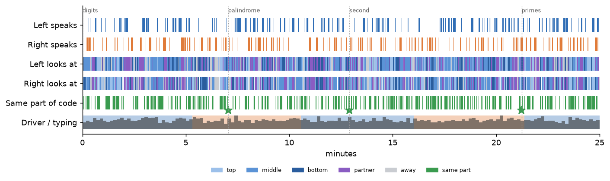
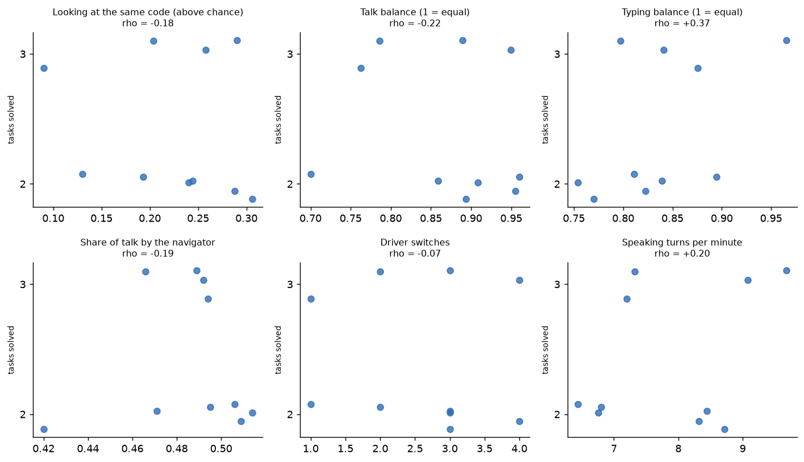

# PairWatch: two students, one screen, one C++ problem

PairWatch is a Windows app for **pair programming in C++** in a real classroom. Two students sit at one laptop and solve programming tasks together. While they work, PairWatch measures **how** they work together:

- **who talks**: microphone + whose mouth is moving
- **where each student looks**: the top, middle or bottom of the code, the partner, or away (from head direction)
- **whether they look at the same part of the code**: joint visual attention, compared with chance
- **who types**: keystrokes counted per driver, plus how often driver and navigator switch roles

It then sets all of this against **how well they solved the problems**: tasks solved, time to solve, test runs, compile errors.

At the end of each session it writes a **pair report**. Across sessions it builds a **class report** that relates collaboration to performance.

**Privacy by design.** No video and no audio are saved. Each camera frame becomes a few numbers (head direction, mouth opening) and is dropped at once. The microphone keeps only loudness. Students are "left" and "right" as seated, never named. Sessions start only after a consent tick.

| Start window | Coding window |
|---|---|
|  |  |

*Screenshots taken automatically on Windows by the build test.*

## Why this project

Pair programming is common in computer science teaching, but a teacher with thirty students cannot see how each pair actually collaborates. Who does the thinking? Does the navigator really guide, or just watch? Do both look at the same code when they talk about it? Research on multimodal learning analytics studies exactly these signals, usually with eye trackers and lab equipment. PairWatch asks how much of that can be done with one ordinary laptop in an ordinary classroom, and keeps the limits honest.

## Install (Windows)

1. Download **`PairWatch-Setup-….exe`** from the [Releases page](https://github.com/Zubair-DLCS/PairWatch/releases/latest).
2. Run it. If Windows says *"Windows protected your PC"* (the app is not code-signed), click **More info → Run anyway**. No admin rights are needed.
3. Click the **PairWatch** icon on your desktop.

A C++ compiler (MinGW-w64 g++) is included, so nothing else needs installing. A portable `.zip` is also on the Releases page.

## A session, step by step

1. **Start window.** Type the pair's name (e.g. "Pair 3"), choose the camera, and tick the consent box after telling the students what is measured.
2. **Camera check.** The camera view (faces pixelated) shows "Faces found: 2 of 2". Then a 10-second calibration: both students look at a red dot at the middle, top and bottom of the screen.
3. **Coding.** Six C++ tasks, from warm-up to harder: sum of digits, palindrome, second largest, primes in a range, balanced brackets, spiral matrix. Each has automatic tests.
   - The **driver** types and the **navigator** guides.
   - **F2** switches roles; **F5** compiles and runs the tests.
4. **End session.** The pair report opens in the browser.
5. **Class report** (start window): every session so far, with each collaboration measure plotted against tasks solved.

To add your own tasks, put a `tasks.json` file in `Documents\PairWatch`:

```json
[{"id": "max3", "title": "Largest of three", "level": 1,
  "text": "Read three integers and print the largest.",
  "tests": [["1 5 3\n", "5"], ["-2 -9 -4\n", "-2"]]}]
```

## What is measured

| Measure | How | Why it matters |
|---|---|---|
| Talk share, overlap, turns per minute | Speech from the microphone, attributed to the student whose mouth is moving | Balanced, back-and-forth talk is a classic sign of real collaboration |
| Navigator's share of talk | Talk by the student who is *not* typing | In good pair programming the navigator guides, not only watches |
| Looking at the code, at the partner, away | Head direction from MediaPipe face landmarks, calibrated per student | Attention to the shared work |
| Joint visual attention (and above chance) | Both students looking at the same third of the code at the same moment, minus what chance would give | Shared focus is linked to shared understanding in collaborative-learning research |
| Typing share, driver switches | Keystrokes (counted, not stored) per driver | Who does the hands-on work, and whether roles rotate |
| Tasks solved, minutes per task, test runs, compile errors | The built-in test runner | Performance |

## Example reports

The examples below use **synthetic sessions** (`python scripts/demo_sessions.py`). They show what the reports look like, not real classroom results.

**Pair report timeline:** who speaks, where each student looks, when both look at the same code, who drives and types, and when tasks were solved.



**Class report:** each collaboration measure against tasks solved, with rank correlations.



## Honest limits

- **One webcam is not an eye tracker.** "Looking at the same part of the code" means roughly the same third of the screen, from head direction, not exact lines.
- **Speaker attribution can miss.** Quiet speech, a hand over the mouth, or noise from the next pair can confuse it. Placing pairs apart helps.
- **Small classes give weak statistics.** With 10–15 pairs, correlations in the class report are patterns to discuss, not proof. Stronger students may simply talk more *and* solve more.
- **Not a grading tool.** The measures describe a process. They should start a conversation with the pair, never replace the teacher's judgement.

## Run from source

```bash
pip install -r requirements.txt     # Python 3.10–3.12
python pairwatch_main.py            # the app (needs g++ on PATH, or MinGW / Dev-C++ installed)
python scripts/demo_sessions.py     # synthetic sessions + example reports
pytest -q                           # tests: C++ tasks, attribution, calibration, metrics, reports
```

| Path | What it does |
|---|---|
| `pairwatch/app.py` | start window, camera check & calibration, coding window, self-test |
| `pairwatch/sensing.py` | camera + microphone → numbers at 5 Hz (frames and sound are dropped) |
| `pairwatch/attribution.py` | head direction → screen region; speech + mouth movement → speaker |
| `pairwatch/cpp.py`, `tasks.py` | C++ tasks, compiling and testing with g++ |
| `pairwatch/metrics.py`, `report.py` | collaboration and performance measures; pair and class reports |
| `.github/workflows/build-windows.yml` | builds the Windows app with MinGW, runs a full automatic session, publishes releases |

## Author

**Malak Zubair**, Assistant Professor of Computer Science, G.C.M.S Timergara, Khyber Pakhtunkhwa, Pakistan. GitHub: [Zubair-DLCS](https://github.com/Zubair-DLCS)

MIT licence. MediaPipe (Apache-2.0) and MinGW-w64/GCC (GPL with runtime exception) are bundled in the Windows app.
